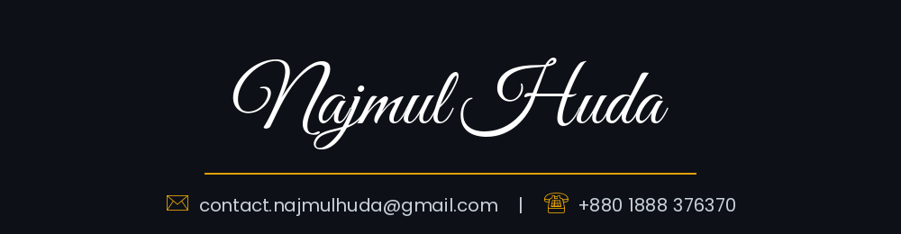
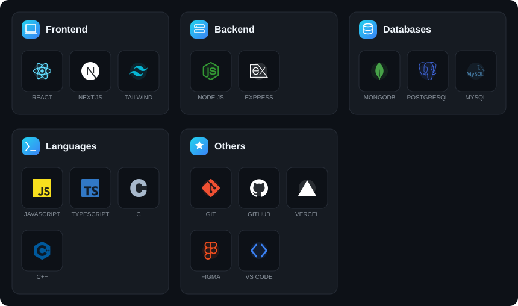

  
  <!--  -->
  
  

<h1 align="center">About Me</h1>

Software Engineer with strong expertise in full-stack web development (TypeScript, Node.js, React, Next.js,
PostgreSQL), backed by competitive programming experience (ICPC/IUPC). Skilled in maintaining production codebases, optimizing backend logic, and leveraging AI coding tools to build scalable, reliable solutions. Eager to contribute technical proficiency and strong problem-solving skills to high-impact engineering teams.

 

  

<h1 align="center">Skills & Tech </h1>

  

<h1 align="center">Projects</h1>

<code>📅 July 2026</code>

<h3 align="center">Netrokona University Computer Club</h3>

  
  
  
  

  

 

  <code>📅 Jun 2026</code>

<h3 align="center">Aura Canvas – Online Art Marketplace</h3>

  
  
  
  
  
  
  

  
  

 

**🆔 ICPC ID:** [E20K3SWR4FXW](https://icpc.global/ICPCID/E20K3SWR4FXW)

 

[portfolio](https://najmul70.vercel.app/) ✉ contact.najmulhuda@gmail.com &nbsp;|&nbsp; ☎ +880 1888 376370

